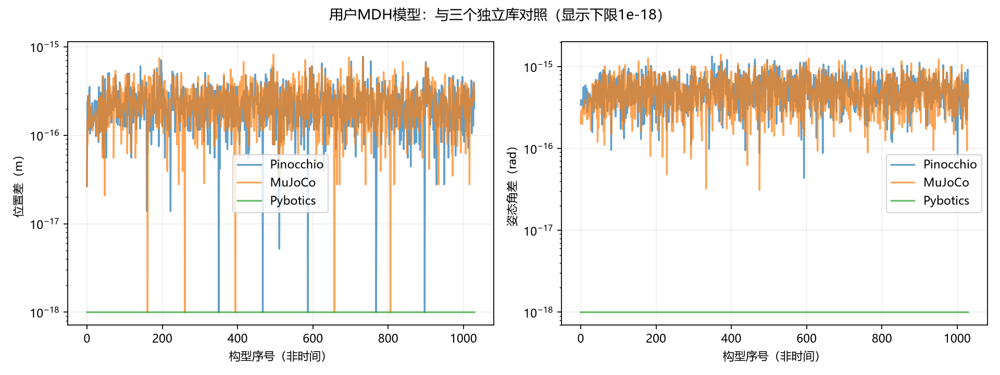
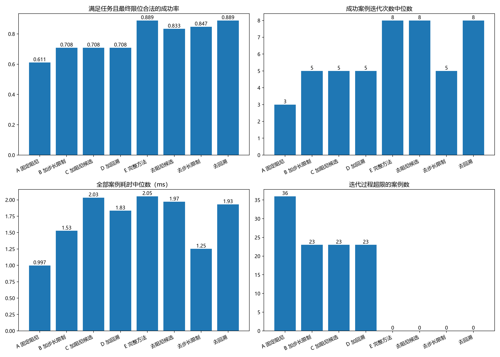
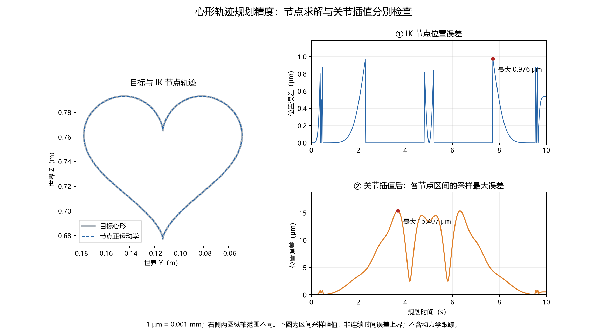
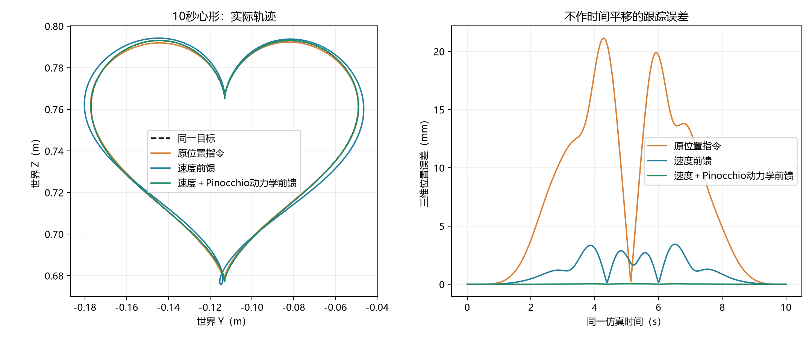
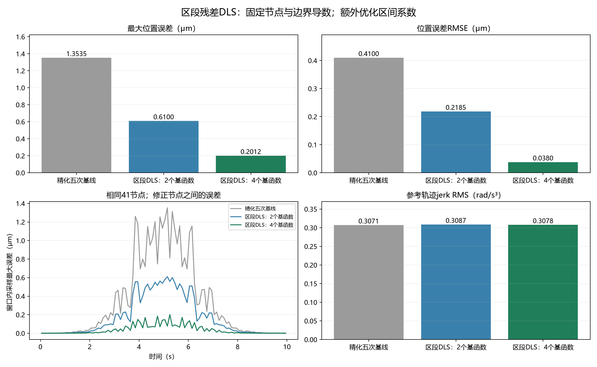
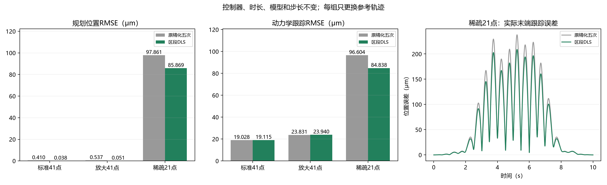

# Flexiv Rizon4：建模、心形轨迹与区段残差DLS

本项目围绕七自由度Flexiv Rizon4机械臂，完成从MDH建模、正逆运动学分析，到固定姿态心形轨迹规划和动力学跟踪的实验流程。在统一的机器人模型与末端坐标约定下，分别研究模型计算一致性、逆解合法性、节点之间的轨迹精度，以及控制器执行参考轨迹时的跟踪误差，并在精化五次样条基础上实现区段残差DLS修正。

机械臂末端沿心形运动，需要解决的不只是“给定位置能否求出关节角”。离散节点上的逆解可以很准确，但节点连接后的关节曲线未必仍对应目标心形；即使几何路径足够准确，执行器与控制器也可能产生明显跟踪偏差。因此，项目把建模、求解、插值和动力学执行连接起来，又用对照实验区分各环节的影响。区段改进建立在这些实验观察之上：当单点DLS扩展无法继续改善密集心形轨迹时，将优化对象转向节点之间的连续关节曲线。

项目采用 **Pinocchio动力学模型与MuJoCo仿真**，没有独立推导整套动力学方程，也没有进行真机实验。

## 项目实现

项目保留8项实验及其计算模块、原始结果、图表和验证代码，按运动学、逆运动学、轨迹跟踪、轨迹平滑分类组织。实验编号沿用结果记录中的编号，以便追溯数据。

| 部分 | 项目中的实现 | 对照与验证范围 |
|---|---|---|
| MDH与正运动学 | 独立NumPy变换链、基座变换、关节角偏置、末端位姿和几何Jacobian | 1030个构型跨实现对照；有限差分、约定错误及参数扰动分析 |
| 逆运动学 | 适配Rizon4的位置/位姿任务、阻尼候选、限步、回溯、关节限位和独立停止阈值 | 8种策略，每种72个目标/任务/初值组合，共576组求解记录；独立MDH复核 |
| 心形规划 | 固定末端姿态、相邻解热启动、时间参数化、关节插值及密集误差检查 | 节点误差与插值误差分开统计；基础/扩展DLS直接对照 |
| 动力学控制 | 位置指令、速度前馈和逆动力学前馈；处理模型已有重力补偿及armature | 同任务控制对照，记录同步误差、力矩、限位和执行器饱和 |
| 轨迹平滑 | 统一样条位置、速度、加速度接口，设置端点条件并精化IK节点 | 线性、三次、五次与精化五次曲线对照；跟踪、jerk及力矩变化分析 |
| 区段残差DLS | 端点二阶锁定基函数、多点残差、系数Jacobian、DLS系数更新与接受检查 | 41/81节点及放大心形规划对照；两基函数与四基函数比较 |
| 区段算法动力学检验 | 固定控制器，仅更换基准/修正后的参考轨迹 | 标准41点、放大41点、稀疏21点，共6组动力学记录 |
| 独立验证 | 保存数据重放、MDH复核、导数与连续性检查、统计重算及来源哈希记录 | 求解结果、规划结果和仿真统计分别检查 |

Pinocchio提供机器人计算接口，MuJoCo提供动力学仿真，SciPy提供样条插值。项目实现的是模型与坐标统一、实验协议、求解器扩展、控制指令适配、区段修正算法及结果验证流程；这些实现与直接使用的库接口在[代码来源与项目改动](docs/代码来源与项目改动.md)中逐项对应。

## 建模与运动学

### MDH变换链与正运动学

采用Craig修正DH约定，单节变换写为：

$$
{}^{i-1}T_i=R_x(\alpha_{i-1})T_x(a_{i-1})R_z(q_i+\theta_{i,0})T_z(d_i).
$$

七个关节的变换依次相乘，并加入世界系到MDH零系的基座变换。基座平移为$(0,0,0.365)$ m，统一比较的末端为`link7` BODY原点，而非另外定义的工具TCP。参数表与坐标示意见`docs/assets/`。实现不只保存参数，还显式处理角度偏置、变换顺序和坐标关系，使MDH计算能够作为独立检查路径。

实验11在1030个构型上，将独立MDH与Pinocchio、MuJoCo及Pybotics参考实现对照。最大位置差约为$8.2\times10^{-16}$ m，处于浮点舍入量级。几何Jacobian通过有限差分检查，配合约定错误和参数扰动实验，检查实现是否正确表达了预期的关节变换。这里的微小误差说明理想模型的计算一致，不表示真实机械臂具有相同定位精度。



### DLS逆运动学与消融

逆运动学参考Pinocchio官方示例，以位姿残差及其Jacobian构建阻尼最小二乘更新。在统一的残差定义下，基本更新为：

$$
\Delta q=-J^T(JJ^T+\lambda^2I)^{-1}e.
$$

固定阻尼的单次更新并不能同时处理不同初值、局部病态和关节限位。项目加入多阻尼候选以尝试不同尺度的更新，限制单次关节步长避免过大的跳变，通过回溯寻找残差下降的步长，并显式处理关节上下界。位置任务与完整位姿任务使用各自的达标条件，防止仅凭单一混合残差判断求解成功。

实验06使用12个目标、2类任务和3种初值，每种策略共72个条件。8种策略形成576组记录。合法成功要求任务误差达标且最终关节角不超限；固定基线虽然72组任务残差均达标，但其中28组最终超限，因此合法成功数为44。

| 策略 | 合法成功数 | 对照关系 |
|---|---:|---|
| 固定阻尼基线 | 44/72 | 统一任务与阈值后的基础实现 |
| 增加步长限制 | 51/72 | 基线上加入限步 |
| 再增加阻尼候选 | 51/72 | 逐项加入策略 |
| 再增加回溯 | 51/72 | 尚未加入限位处理 |
| 完整方法 | 64/72 | 阻尼候选、限步、回溯、限位共同启用 |
| 完整方法去掉阻尼候选 | 60/72 | 单模块消融 |
| 完整方法去掉限步 | 61/72 | 单模块消融 |
| 完整方法去掉回溯 | 64/72 | 单模块消融 |

逐项增加策略与从完整方法移除策略回答不同问题。前者展示组合过程，后者在其余模块保持启用时观察一个模块的影响。本测试集中，阻尼候选和限步对完整方法的合法成功数有贡献；去掉回溯后成功数不变，不能据此宣称回溯也提高了成功率。完整方法没有出现记录中的迭代状态超限，但其计算开销高于固定基线。



## 心形轨迹与动力学跟踪

### 从离散逆解到关节曲线

实验07在世界YZ平面定义心形，保持末端姿态不变，以相邻节点的解作为下一节点初值。标准任务持续10秒，使用401个节点，并对连接后的关节曲线重新计算末端位置。节点最大位置误差约0.976 μm，插值检查采样最大误差约15.407 μm。

关节空间中的插值经过非线性正运动学映射后，不会自动成为笛卡尔空间中的目标曲线。这解释了节点准确而区间误差更大的现象。节点数量、插值形式和逆解精度共同影响路径质量，不能只报告IK节点误差。

实验12将基础DLS与完整扩展DLS用于同一心形，分别进行共同初值和独立热启动对照。两者均成功求解401个节点，节点误差与插值误差相同。相邻热启动使任务已经处于容易求解的局部区域，单点求解器的稳健性扩展在这里没有转化为轨迹精度收益。该结果将后续改进方向从“继续调整单点求解策略”转向“直接约束区间路径”。



### 控制与平滑性

实验09在相同心形任务下比较位置指令、速度前馈和动力学前馈。标准工况的同步位置RMSE分别约为10.1905 mm、1.5513 mm和0.02669 mm。动力学前馈利用Pinocchio计算所需动力学量，再根据位置执行器模型构造指令偏置，并处理已有重力补偿与armature，降低参考运动与实际运动之间的偏差。



控制精度提高之后，关节线性插值在节点处的速度变化成为平滑性问题。实验10固定控制方案，比较线性、三次、五次和精化五次曲线。标准工况下，精化五次曲线的跟踪RMSE约0.01912 mm；实际运动的离散jerk RMS由线性插值的23.577降至0.388 rad/s³，最大相邻力矩变化由约0.49988降至0.00634 N·m。因而平滑处理的价值不仅在位置误差，也在运动和控制输入的变化程度。

精化五次样条随后作为实验14的基准轨迹，实验10的控制器用于实验15。规划算法和控制器由此可以分别对照，避免把控制改进的收益计入区段算法。

## 区段残差DLS

### 将优化对象移到节点之间

逐点IK只要求各节点满足目标位姿。节点一旦求解完成，插值函数就决定了中间的关节运动；单点DLS没有直接看到这些中间时刻的误差。继续压低节点容差，不能保证消除插值造成的路径偏离。增加节点是可行方向，但会改变节点预算，也无法单独回答现有节点之间是否还有可利用的修正空间。

项目保留基准样条和已有IK节点，在每个区段内增加受约束的修正。比较时固定节点数量，使基准和改进使用同一组边界条件；误差变化来自区段内部曲线的调整。固定节点不代表相同计算成本：修正增加了未知量和FK/Jacobian计算，适用于本项目的离线规划实验。

令区段局部时间$s=(t-t_i)/(t_{i+1}-t_i)$，修正后的关节曲线为：

$$
\widetilde q_i(s)=q_i^{\mathrm{base}}(s)+\sum_{k=0}^{K-1}b_k(s)c_{ik},\qquad
b_k(s)=64s^3(1-s)^3(2s-1)^k.
$$

其中$c_{ik}\in\mathbb R^7$为关节修正系数，完整方法取$K=4$。公共因子$s^3(1-s)^3$使修正基在两端的函数值、一阶导数和二阶导数都为零。因此，修改区段内部不会改变节点处的关节位置、速度和加速度，也不会破坏基准轨迹已有的C²连接。因子64将公共基函数在区间中点的值归一化为1；不同阶次的$(2s-1)^k$提供不同的区间修正形状。两基函数与四基函数对照则用于观察修正自由度的作用。

这一表示把“允许修改什么”直接写入曲线结构：已有节点和边界导数保持不变，优化只作用于内部形状。它避免逐个移动中间关节样本后再重新插值所带来的边界协调问题，但不保证三阶导数连续，也不自动保证整段误差或动力学指标最优。

### 多点残差与系数更新

每个区段在多个内部时刻计算目标位姿与当前位姿的残差，将它们堆叠为$r$。目标不再是让一个时刻的末端位置达标，而是共同降低该区段多个时刻的偏差。相应地，原来对关节角求导的残差Jacobian，需要通过链式法则转换为对系数求导：

$$
A_j=
\begin{bmatrix}
b_0(s_j)J_j\\
b_1(s_j)J_j\\
\vdots\\
b_{K-1}(s_j)J_j
\end{bmatrix}
$$

$$
A=
\begin{bmatrix}
A_1\\
A_2\\
\vdots\\
A_M
\end{bmatrix}
$$

将区段系数展平成向量$c$，DLS更新写为：

$$
\Delta c=-(A^TA+\lambda^2I)^{-1}A^Tr,\qquad c_{\mathrm{trial}}=c+\alpha\Delta c.
$$

多个时刻可能要求不同方向的修正，DLS以最小二乘形式折中这些要求。阻尼项抑制局部病态条件下过大的系数变化，但单次线性化不保证真实非线性误差下降。因此，实现还限制系数步长，并采用回溯尝试不同的$\alpha$。候选修正需要同时降低训练点和另一组错开检查点的残差，并检查位置、姿态最大误差不恶化。

训练点决定优化方向，独立检查点用于发现“只在优化采样点上变好”的修正。实现还利用$|b_k(s)|\leq1$与系数绝对值之和形成关节修正幅度界，结合基准曲线的关节余量检查限位，并以采样jerk预算约束过于激进的形状调整。这些检查减少接受不合适修正的机会；采样检查仍不等于连续时间误差上界或连续时间jerk峰值证明。

相关实现集中在`segment_dls.py`：`profiles()`构造修正基，`SegmentCurve`统一计算修正轨迹及其导数，`segment_system()`构造多点残差和系数Jacobian，`correct_segments()`执行DLS更新、限步、回溯及候选检查。独立验证脚本进一步检查导数、边界连续性、限位以及MDH重放误差。

### 固定节点的规划对照

实验14的基准已经包含精化IK和五次样条，不是未经适配的官方IK示例。标准41节点形成40个区段；四个基函数对应每段28个系数，共1120个额外参数。节点数相同，但优化自由度和计算量增加。

| 标准41节点 | 精化五次基线 | 两基函数修正 | 四基函数修正 |
|---|---:|---:|---:|
| 最大位置误差 / μm | 1.3535 | 0.6100 | 0.2012 |
| 位置RMSE / μm | 0.4100 | 0.2185 | 0.0380 |
| 参考jerk RMS / rad/s³ | 0.3071 | 0.3087 | 0.3078 |
| 单次记录规划时间 / s | 0.0525 | 1.7373 | 2.8295 |

四基函数方法的最大规划误差降低约85.13%，位置RMSE降低约90.72%。两基函数也有改善，而四基函数进一步降低误差，支持在当前任务中增加区段形状自由度的有效性。参考jerk RMS约增加0.20%，峰值约增加6.8%；几何误差下降伴随计算开销和平滑性代价，并非所有指标同时改善。单次耗时记录也不能解释为跨设备稳定性能或实时性保证。



### 同控制器的动力学对照

实验15保持控制器、模型、时长和仿真步长不变，每组仅替换基准或修正后的参考轨迹。

| 工况 | 基准跟踪RMSE / μm | 区段DLS跟踪RMSE / μm |
|---|---:|---:|
| 标准41节点 | 19.0283 | 19.1154 |
| 放大41节点 | 23.8315 | 23.9396 |
| 稀疏21节点 | 96.6037 | 84.8381 |

41节点时，规划误差已经显著小于实际跟踪误差，进一步改善几何路径没有带来跟踪RMSE收益，两组数值反而略升。稀疏21节点时，规划偏差增大，区段修正使跟踪RMSE降低约12.18%。结合实际运动相对参考轨迹的误差仍约19 μm，这与“规划误差较大时更容易观察到修正收益”的解释一致，并不意味着控制器本身得到改进。



21节点修正后的最大几何误差仍约218 μm，高于原100 μm规划阈值，因此它是压力对照，并非满足原精度要求的规划方案。规划最大误差下降85.13%与跟踪RMSE下降12.18%分别来自41节点和21节点、不同评价指标，不能合并为一个提升比例。

区段方法使用已有的DLS、样条和残差优化思想。项目中的具体扩展是端点二阶锁定的修正表示、多点残差到系数Jacobian的构造，以及与误差、限位、平滑性检查相结合的接受流程。现有实验支持它相对本项目基线的效果，不构成文献首创或优于所有轨迹优化方法的结论。


## 实验入口

| 顺序 | 内容 | 入口（从项目根目录运行） | 结果 |
|---|---|---|---|
| 1 | MDH建模、正运动学和Jacobian验证 | `experiments/kinematics/experiments_11_mdh_analysis.py` | `results/mdh_analysis/` |
| 2 | 逆运动学：DLS对照与消融 | `experiments/inverse_kinematics/run_06_reference.py` | `results/ik_comparison/` |
| 3 | 固定姿态心形规划及基础跟踪 | `experiments/trajectory_tracking/experiments_07_heart_trajectory.py` | `results/heart_trajectory/` |
| 4 | 速度与动力学前馈控制对照 | `experiments/trajectory_tracking/experiments_09_heart_tracking_comparison.py` | `results/heart_comparison/` |
| 5 | 样条平滑与动力学表现 | `experiments/trajectory_smoothing/experiments_10_smooth_tracking.py` | `results/smooth_tracking/` |
| 6 | 基础/扩展DLS的心形直接对照 | `experiments/trajectory_tracking/experiments_12_heart_dls_comparison.py` | `results/heart_dls_comparison/` |
| 7 | 固定节点的区段残差DLS | `experiments/trajectory_smoothing/experiments_14_segment_dls.py` | `results/segment_dls/` |
| 8 | 区段DLS动力学跟踪对照 | `experiments/trajectory_smoothing/experiments_15_segment_tracking.py` | `results/segment_tracking/` |

## 安装与运行

```bash
conda env create -f environment.yml
conda activate final_report

# 原心形规划与动力学仿真
python experiments/trajectory_tracking/experiments_07_heart_trajectory.py --simulate

# 区段DLS规划和动力学实验
python experiments/trajectory_smoothing/experiments_14_segment_dls.py
python experiments/trajectory_smoothing/experiments_15_segment_tracking.py
```

默认运行会覆盖相应结果。支持的入口可通过 `--out results_local/...` 保留随包数据；验证脚本的结果路径选项见 `--help`。实验15的标准/放大41节点读取实验14保存的NPZ，包内已提供这些输入。

完整MDH实验11额外需要Pybotics参考实现：

```bash
python -m pip install --no-deps -r requirements-mdh.txt
python experiments/kinematics/experiments_11_mdh_analysis.py
```

不使用Robotics Toolbox。Pybotics 3.1.2声明NumPy<2，已有记录仅在NumPy 2.5.4下验证所用FK/Jacobian接口；不能推定全面兼容。独立NumPy MDH复核和其余轨迹实验不依赖Pybotics。

`environment.yml`是环境声明，未完成全新环境安装或跨平台测试；历史版本与新实验版本见 `ENVIRONMENT_TESTED.json` 和各结果元数据。

## 验证

除实验对照外，我还使用独立MDH重放、边界导数检查和原始数据统计重算，对算法实现与结果进行复核。

```bash
python validation/inverse_kinematics/verify_06_reference.py
python validation/kinematics/verify_mdh_ik.py
python validation/trajectory_smoothing/verify_segment_dls.py
python validation/trajectory_smoothing/verify_segment_tracking.py
```

保留的控制与平滑验证入口分别是 `validation/comparison/verify_comparison.py`、`validation/trajectory_smoothing/verify_smooth_tracking.py`。已记录的检查范围见 [PACKAGE_VALIDATION.json](PACKAGE_VALIDATION.json)。历史运行元数据保留原样，不能把整理或数据复核称为所有实验重新运行。

## 项目结构

```text
final_report/
  README.md                  项目介绍、实验分析及复现入口
  experiments/               按内容分类的8项实验与依赖模块
  validation/                独立验证代码
  flexiv_rizon4/             MJCF模型、网格和模型许可证
  results/                   保留实验的原始记录、图和元数据
  docs/                      代码来源说明与MDH图表
  references/                所引用上游源码的归档快照与许可
  MODEL_SOURCE.txt           模型来源及版本边界
  SOURCE_PROVENANCE.json     参考来源记录
  source_manifest.json       当前代码哈希
  environment.yml           环境声明
```

## 文档

- [代码来源与项目改动](docs/代码来源与项目改动.md)

## 参考与许可

TORM和Hauser的工作作为相关研究参考；本项目在Pinocchio逆运动学与五次样条基础上，实现了固定节点及边界导数的区段残差DLS修正。

- [Pinocchio IK示例](https://github.com/stack-of-tasks/pinocchio/blob/f3b3953babbc65f9c91f294f956836ee5a6c9d0e/examples/inverse-kinematics.py)：SE(3)、Jlog6与DLS的参考代码，保留[原始快照](references/pinocchio_inverse_kinematics_original.py)与[BSD许可证](PINOCCHIO_LICENSE.txt)。
- [MuJoCo Menagerie Rizon4](https://github.com/google-deepmind/mujoco_menagerie/tree/f3b6013629c7b94f8ee93fd977b161fa8350f9bc/flexiv_rizon4)：模型与网格，保留[Apache-2.0许可证](flexiv_rizon4/LICENSE)及[来源记录](MODEL_SOURCE.txt)。
- [SciPy样条](https://docs.scipy.org/doc/scipy/reference/generated/scipy.interpolate.make_interp_spline.html)：调用库API，保留[源码快照](references/scipy_bsplines_original.py)与[许可证](references/SCIPY_LICENSE.txt)。
- [Pybotics](https://github.com/engnadeau/pybotics)：MDH参考实现，保留[来源与哈希](references/pybotics/provenance.json)及[MIT许可证](references/pybotics/LICENSE)。
- [TORM](https://sglab.kaist.ac.kr/TORM-auro/)和[Hauser 2013](https://motion.cs.illinois.edu/papers/RSS2013_InterpolationOptimizationManifolds.pdf)：相关研究，未复制其源码，也未做与其算法的性能排名。

第三方许可证只适用于对应内容；项目自有代码未另行指定统一开源许可证。完整参数表、参考资料与来源记录均保留。

## 解释边界

末端为世界系中的link7 BODY原点；Craig MDH基座平移为(0,0,0.365) m。规划几何误差、仿真跟踪误差与真实硬件精度不是同一指标。采样最大误差不是连续时间上界，合法逆解也不构成整条轨迹无碰撞证明。
