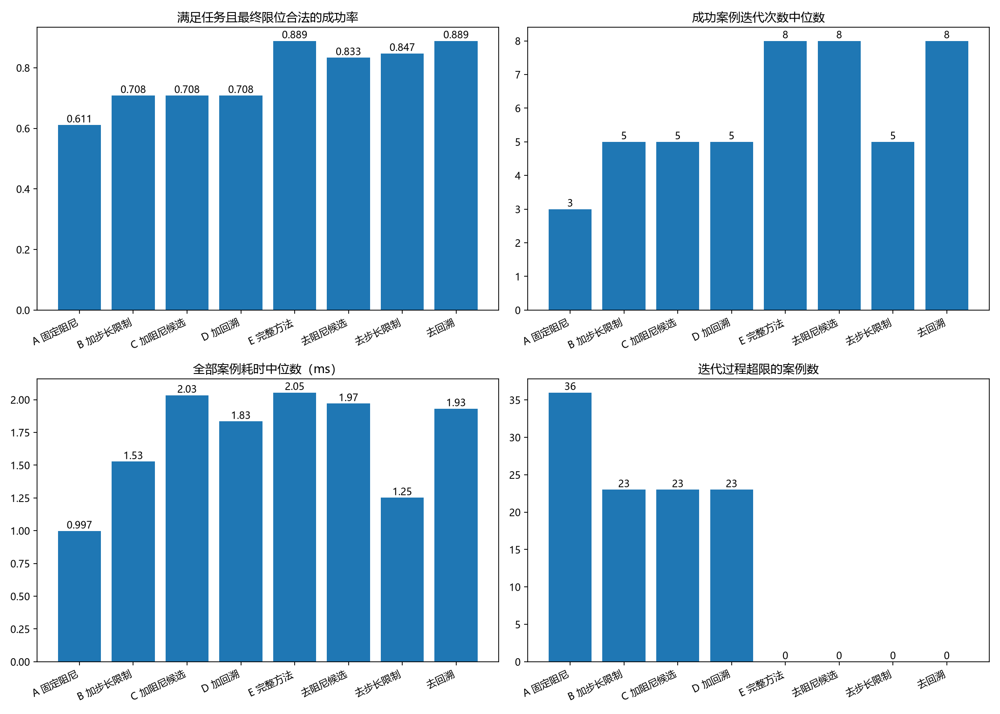
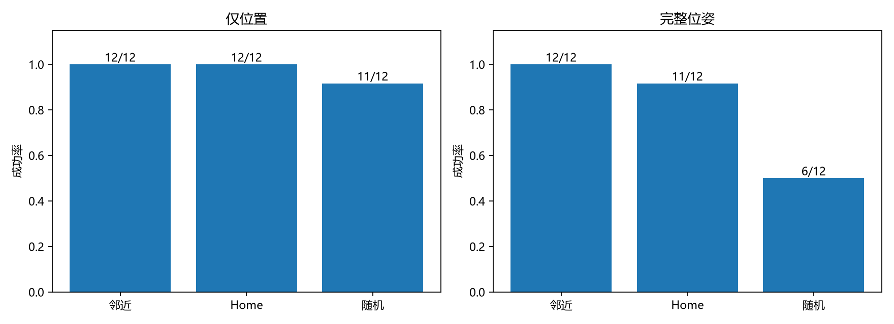
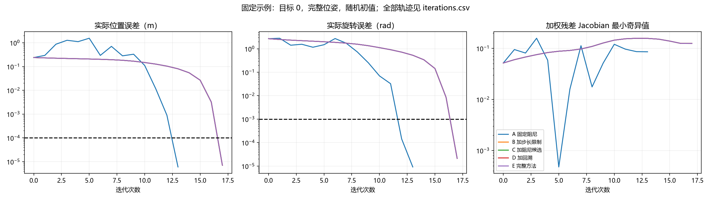

# 实验 06 实测报告（学习与测试参考）

## 条件与评价口径
种子 42；12 个已知限位内有解的目标；每目标 2 种任务 × 3 种初值；每算法重复 3 次测时。
完全沿用原目标采样（限位内10%余量）、邻近初值 N(0,0.15 rad)、Home 第4关节1.57 rad、随机初值设计。邻近初值使用参考解，只是诊断条件。
所有组：250次最大迭代，实际位置阈值 1e-4 m，完整位姿旋转阈值 1e-3 rad，旋转权重0.2；固定更新比例1。λ=1e-3，多候选=(1e-3,1e-2,1e-1,1)，正则项为 λ²I；步长上限0.2 rad，回溯最多10次。以 metadata.json 为本次参数准据。
主成功率=任务误差通过且最终关节限位合法（1e-10 rad数值容差）。另报纯任务成功与过程/最终超限，过程超限不计作最终解失败，但不能当作可执行轨迹。仅位置任务的旋转误差不参与成功判断。
耗时包含所有组共有的轨迹记录和SVD成本，排除画图/文件写入；预热并随机化算法顺序，逐案例取重复测时中位数。不同算法成功子集可能不同，不能仅凭成功迭代中位数判断速度。

## 06.1 基础与扩展、06.3 消融汇总
|算法|合法成功|纯任务成功|成功迭代中位数|全部耗时中位数/ms|过程超限案例|最终超限案例|
|---|---:|---:|---:|---:|---:|---:|
|A 固定阻尼|44/72|72|3.0|0.997|36|28|
|B 加步长限制|51/72|72|5.0|1.527|23|21|
|C 加阻尼候选|51/72|71|5.0|2.034|23|21|
|D 加回溯|51/72|71|5.0|1.834|23|21|
|E 完整方法|64/72|64|8.0|2.055|0|0|
|去阻尼候选|60/72|60|8.0|1.970|0|0|
|去步长限制|61/72|61|5.0|1.252|0|0|
|去回溯|64/72|64|8.0|1.931|0|0|

本批次完整方法相对基础组，合法成功数由 44 变为 64（均 72 次）；耗时中位数由 0.997 ms 变为 2.055 ms。这是当前样本结果，不能推广为普遍优越。
C组多候选通过目标下降筛选，没有回溯；因此B→C同时引入候选筛选机制。完整方法去掉候选的对照仍保留回溯和下降判据，用于更直接隔离候选集合的作用。D就是完整方法去限位。
- D 加回溯：相对完整方法，合法成功数变化 -13，过程超限案例 23；耗时中位数 1.834 ms。单项移除结果受其他组件交互影响。
- 去阻尼候选：相对完整方法，合法成功数变化 -4，过程超限案例 0；耗时中位数 1.970 ms。单项移除结果受其他组件交互影响。
- 去步长限制：相对完整方法，合法成功数变化 -3，过程超限案例 0；耗时中位数 1.252 ms。单项移除结果受其他组件交互影响。
- 去回溯：相对完整方法，合法成功数变化 +0，过程超限案例 0；耗时中位数 1.931 ms。单项移除结果受其他组件交互影响。

## 06.2 原六组设计
|任务|初值|合法成功|成功迭代中位数|
|---|---|---:|---:|
|position|near|12/12|3.0|
|position|home|12/12|9.0|
|position|random|11/12|12.0|
|pose|near|12/12|3.0|
|pose|home|11/12|13.0|
|pose|random|6/12|15.0|

## 06.4 误差、曲线、验证及结论边界
summary.csv 提供全部/成功子集的位置误差、旋转误差、耗时与路径最小奇异值中位数；solutions.csv 记录逐例最终值，iterations.csv 保存每个迭代状态的误差、关节角、最小奇异值、阻尼和步长。姿态残差的平移分量不是世界位置差，报告的实际位置误差另行计算。
奇异值属于优化任务的残差 Jacobian：pose含Jlog6和旋转权重，position为3×7位置Jacobian。不同任务奇异值不可直接比较，不能单凭这些值宣称验证了奇异位形鲁棒性。图中固定展示目标0的完整位姿随机初值，无曲线延长或成功筛选。
验证：Pinocchio 与 MuJoCo 的FK/位置Jacobian交叉检查、任务残差中心差分检查、全部六组案例的完整实验方法与原solve_ik逐例一致性、重复运行一致性。数值详见 metadata.json。
小样本、单种子、无碰撞检查；限位内运动学有解不意味着无碰撞可达，局部算法失败也不意味着不可达。未依据测试集调参，不保证基础固定阻尼已达到最佳性能。

## 官方来源与项目边界
[Pinocchio 官方 inverse-kinematics.py](https://github.com/stack-of-tasks/pinocchio/blob/devel/examples/inverse-kinematics.py)（2026-11-01核对，devel为可变分支）。官方已有 SE(3) log 残差、Jlog6修正、DLS及integrate；原示例DT=0.1、damp=1e-12直接加到JJᵀ。
本实验A是为公平组件比较而适配的基础DLS，不是原示例参数逐字复现：统一项目BODY末端、两任务、权重及物理误差停止条件，固定比例1与λ²=1e-6。不得将其结果描述为击败官方默认示例。项目扩展为阻尼候选、步长限制、回溯、限位投影及实验记录，并非新DLS数学算法。原文件与许可证保留在包内。

## 实际误差（成功案例中位数，按任务分开）
|算法|任务|成功数|位置误差/mm|旋转误差/rad|
|---|---|---:|---:|---:|
|A_fixed|position|25|0.00401724|0.876435|
|A_fixed|pose|19|0.0207179|3.73283e-05|
|E_full|position|35|0.00964374|1.47856|
|E_full|pose|29|0.00743005|2.1097e-05|

## 相同成功子集的配对比较
仅完整方法成功 20 例；仅基础组成功 0 例；双方均成功 44 例；双方均失败 8 例。
双方成功子集：完整方法减基础组的迭代次数差中位数 1；逐案例耗时差中位数 0.551 ms。负值代表完整方法较小。